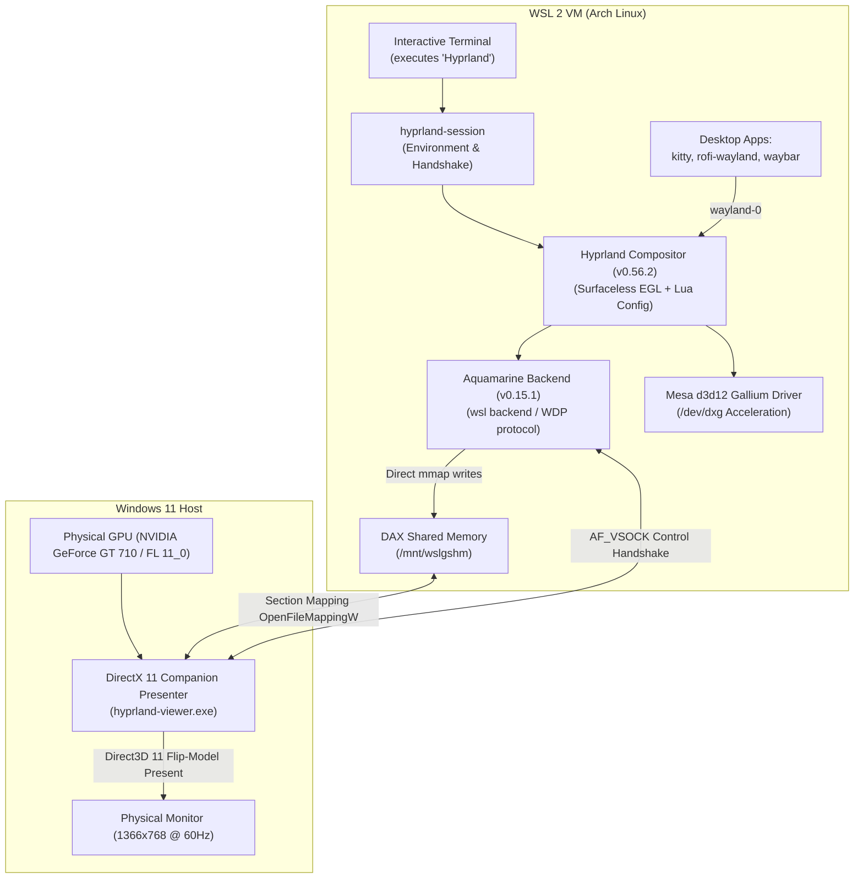

# Hyprland-WSL 🚀

> **Pure upstream Hyprland compositor running natively in Arch Linux on WSL 2 with hardware GPU acceleration (DirectX 11 / Direct3D 12) and zero-copy 60 FPS presentation.**

---

## 🌟 Highlights

- **Hardware Acceleration:** Uses Mesa's Direct3D 12 Gallium driver over WSL's `/dev/dxg` interface, providing full OpenGL ES 3.0 / EGL hardware acceleration even on legacy GPUs with Feature Level 11_0 (such as NVIDIA GeForce GT 710 / Kepler architecture).
- **DirectX 11 Companion Presenter:** The Windows-side companion presenter runs on native Direct3D 11 (`d3d11.dll`), ensuring complete compatibility with graphics cards supporting DirectX 11.
- **Zero-Copy Frame Presentation:** Leverages Hyper-V virtio-fs DAX shared memory (`/mnt/wslgshm`). Framebuffers written by Hyprland are memory-mapped directly by the Windows presenter with zero copies across the VM boundary at 6+ GB/s (yielding smooth 60+ FPS).
- **Modern Lua Configuration:** Native support for the modern `~/.config/hypr/hyprland.lua` format introduced in Hyprland v0.55+.
- **Pure Linux CLI Experience:** Type `Hyprland` in your Arch Linux terminal and the real compositor executes in the foreground, streaming authentic ASCII art and logs to your shell.

---

## 🏛️ Architecture Overview



---

## 📁 Repository Structure

```text
hyprland-wsl/
├── README.md                 # Complete project documentation & setup guide
├── CREDITS.md                # Acknowledgements to upstream projects
├── arch/                     # Arch Linux PKGBUILDs and patch sets
│   ├── aquamarine/           # Aquamarine WSL backend & shm patches
│   │   ├── PKGBUILD
│   │   ├── 0001-allocator-shm-allocator-for-backends-without-DRM.patch
│   │   └── 0002-backend-wsl-a-remote-viewer-backend.patch
│   └── hyprland/             # Hyprland DRM-free EGL patches
│       ├── PKGBUILD
│       ├── 0001-render-DRM-free-mode-surfaceless-EGL-shm-output-buff.patch
│       ├── 0002-compositor-select-aquamarine-s-wsl-backend-with-HYPR.patch
│       ├── 0003-pointer-CPU-cursor-buffers-without-dmabuf.patch
│       ├── 0004-protocols-screen-capture-without-linux-dmabuf.patch
│       └── 0005-input-absolute-pointer-motion-relative-to-the-backen.patch
├── config/                   # Configuration presets
│   ├── hyprland.lua          # Official modern Lua config (1366x768 @ 60Hz)
│   ├── hyprland.conf         # Legacy config fallback
│   └── 99-hyprland.conf      # Realtime PAM scheduling priority limits
├── systemd/                  # Systemd mount units
│   └── mnt-wslgshm.mount     # Auto-mounts WSLg DAX shared memory on boot
├── scripts/                  # Shell entry points
│   ├── hyprland-session.sh   # Session environment setup & VSOCK handshake
│   └── hyprland-launcher.sh  # Clean user CLI wrapper (/usr/local/bin/Hyprland)
├── assets/                   # Official vector and multi-res icons
│   ├── hyprland.ico          # Multi-resolution ICO (16x16 to 256x256)
│   └── hyprland_logo.png     # Official high-resolution logo
└── bin/                      # Compiled companion viewer
    └── hyprland-viewer.exe   # Lightweight DirectX 11 presenter window
```

---

## ⚡ Setup & Installation

### 1. Enable Zero-Copy Shared Memory
Install and activate the systemd mount unit inside Arch Linux so `/mnt/wslgshm` is mounted on every boot:
```bash
sudo cp systemd/mnt-wslgshm.mount /etc/systemd/system/mnt-wslgshm.mount
sudo systemctl daemon-reload
sudo systemctl enable --now mnt-wslgshm.mount
```

### 2. Configure Real-Time Priority Limits
Prevent compositor scheduling jitter:
```bash
sudo cp config/99-hyprland.conf /etc/security/limits.d/99-hyprland.conf
```

### 3. Deploy Modern Lua Configuration
Install the new official Lua configuration:
```bash
mkdir -p ~/.config/hypr
cp config/hyprland.lua ~/.config/hypr/hyprland.lua
```

### 4. Install Launcher Scripts
```bash
sudo cp scripts/hyprland-session.sh /usr/local/bin/hyprland-session
sudo chmod +x /usr/local/bin/hyprland-session

sudo cp scripts/hyprland-launcher.sh /usr/local/bin/Hyprland
sudo chmod +x /usr/local/bin/Hyprland
```

### 5. Launch Hyprland
From any Arch Linux terminal inside WSL 2, simply run:
```bash
Hyprland
```

---

## ⌨️ Default Keybindings

| Shortcut | Action |
|---|---|
| `SUPER + RETURN` / `SUPER + Q` | Launch **Foot** terminal |
| `SUPER + SPACE` / `SUPER + R` | Launch **Rofi** application menu |
| `SUPER + SHIFT + S` | Screenshot selection to clipboard (`grim` + `slurp` + `wl-copy`) |
| `SUPER + C` | Close active window |
| `SUPER + V` | Toggle window floating state |
| `SUPER + Left Mouse Drag` | Move floating window |
| `SUPER + Right Mouse Drag` | Resize floating window |
| `SUPER + M` | **Exit Hyprland** and return cleanly to terminal |
| `SUPER + [1-5]` | Switch to Workspace 1–5 |
| `SUPER + SHIFT + [1-5]` | Move active window to Workspace 1–5 |
| `SUPER + Arrow / HJKL` | Move focus left/right/up/down |

---

## 🙏 Credits & Acknowledgements

This project is built upon the pioneering engineering work of:
- **[Hyprland](https://github.com/hyprwm/Hyprland) & [Aquamarine](https://github.com/hyprwm/aquamarine)** by Vaxry and the hyprwm team.
- **[Womarchy / Omarchy](https://github.com/sytelus/womarchy)** by Shital Shah, which created the initial WSL backend patches, virtio-fs DAX section memory sharing, and companion viewer architecture.

See [CREDITS.md](CREDITS.md) for full details.

---

## 📜 License
BSD-3-Clause / MIT. All Hyprland logos and trademarks belong to their respective creators under the Hyprland project.
